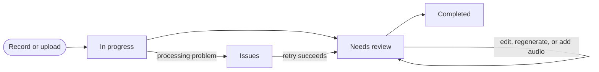

# Track every appointment from recording to completion

An **encounter** is one appointment and its audio, transcript, generated notes, messages, and patient context. The Encounters page is the complete work queue.

## Encounter workflow

### 1. Upload or record the appointment

Start a **New Encounter**, select the patient and note templates, then record in the browser or add existing audio. Review the queue and choose **Process file** or **Process files**.

### 2. Let noctune process the recording

noctune securely saves the audio, transcribes it, and generates the SOAP and discharge notes. You can leave the processing screen and return from the Encounters queue when the draft is ready.

### 3. Review the generated note

When the encounter moves to **Needs review**, open it and verify the SOAP note against the transcript and audio. Patient details and the main actions remain visible at the top.

### 4. Edit and save

Edit any section that needs a correction, then choose **Save**. Saving records an audited edit and locks that section against later recordings, but keeps the encounter open until you complete it.

### 5. Complete the review

Choose **Complete** when the clinical record is ready. The action changes to **Completed**, while the note, transcript, and communication tools remain available.

### 6. Send the discharge summary

Open **Send Email** and choose **Send discharge notes**. Add the recipient and send the client-facing summary. If you open the discharge dialog before completing the encounter, **Send + Complete** performs both actions together; after completion, the action is **Send**.

## Encounter states

- **In progress** means noctune is uploading, transcribing, or generating notes.
- **Needs review** means the draft is ready for a clinician.
- **Completed** means the encounter has been reviewed and finished.
- **Issues** collects encounters that need a retry or another corrective action.

The status displayed on an individual row can be more specific, such as **Transcribing**, **Ready**, or **Completed**.

## Filter, date, and search

Use **All**, **Needs review**, **In progress**, **Completed**, and **Issues** to narrow the queue. The date control can limit results to a recent range or show **All time**.

Search on the Encounters page matches the patient name or source audio filename. It does not search the transcript, owner name, or teammate name. To search indexed SOAP notes and transcripts by meaning, use [global search](../navigation-and-search.md#meaning-based-encounter-search) in the top bar.

## Open an encounter

Choose a row to open the review workspace. The SOAP note is on the left; transcript, messages, and prior visits are on the right. See [Review & Edit](review-and-edit.md) for the available actions.

## In this section

- [New Encounter](new-encounter.md) — record or queue audio
- [Review & Edit](review-and-edit.md) — verify the transcript, edit notes, and finish the encounter
- [Collaborative Notes](collaborative-notes.md) — add recordings and edit one note as a team
